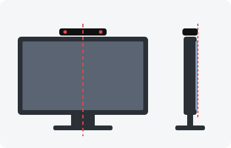

# dbar4gun 1.2.0

[English](README.md) | Español

dbar4gun es un driver de Linux en espacio de usuario para el Wiimote, con soporte para la DolphinBar, pensado para funcionar como 4 light guns.

[](https://ko-fi.com/lowlevel1989)

Si quieres que este driver siga recibiendo actualizaciones y soporte lo más rápido posible, puedes apoyar el proyecto invitándome a un café ☕ para ayudar a que siga adelante.

## Instalar

- **RetroPie**: [retropie/README.es.md](retropie/README.es.md)
- **Otro Linux** (escritorio, Raspbian...): [docs/install-linux.es.md](docs/install-linux.es.md)

Después, calibra desde donde juegas: [docs/calibration.es.md](docs/calibration.es.md).

## Antes de jugar: RetroArch

dbar4gun envía las teclas por defecto de MAME, y algunas son también atajos de
RetroArch (`f` es pantalla completa, `l` es avance rápido...): con 2 o más pistolas
chocarían. Desactívalos solo en los juegos de pistola añadiendo estas líneas a
`/opt/retropie/configs/lightgun/retroarch.cfg`, encima de la línea `#include`:

```
input_toggle_fullscreen = "nul"
input_hold_fast_forward = "nul"
input_frame_advance = "nul"
input_netplay_game_watch = "nul"
```

Si tus emuladores de pistola cargan otro archivo (`--config ...` en
`/opt/retropie/configs/lightgun/emulators.cfg`), pon las líneas en ese archivo.
Detalles: [docs/mapping.es.md](docs/mapping.es.md).

## Botones

| dispositivo | botón     | mapeo           | solo cursor          | compartido   | por defecto en MAME               |
|-------------|-----------|-----------------|----------------------|--------------|-----------------------------------|
| wiimote     | ir        | cursor del ratón| igual                | false        | cursor                            |
| wiimote     | a         | tecla automática| btn a    (Bluetooth) | false        | bomba                             |
| wiimote     | b         | botón izquierdo | igual                | false        | gatillo                           |
| wiimote     | home      | tecla enter     | btn home (Bluetooth) | true / false | select                            |
| wiimote     | 1         | botón central   | btn 1    (Bluetooth) | false        |                                   |
| wiimote     | 2         | botón derecho   | btn 2    (Bluetooth) | false        | recargar (retroarch)              |
| wiimote     | plus      | tecla automática| key next (Bluetooth) | false / true | start                             |
| wiimote     | minus     | tecla automática| key prev (Bluetooth) | false / true | 1 moneda                          |
| wiimote     | d-pad     | tecla automática| flechas  (Bluetooth) | false / true | dirección                         |
| nunchuk     | stick     | d-pad del wiimote | abs hat (Bluetooth) | false       | dirección                         |
| nunchuk     | z         | tecla automática| btn z    (Bluetooth) | false        | MAME: asigna `key b` al botón 2 ([o copia default.cfg](retroarch/mame/README.es.md)) |
| nunchuk     | c         | tecla automática| btn c    (Bluetooth) | false        |                                   |
| combo       | b + home  | tecla tab       | igual                | true         | menú (mame, flycast)              |
| combo       | b + plus  |                 | igual                | false        | desactivar/activar IR (útil en la GUI) |
| combo       | b + minus | tecla esc       | igual                | true         | salir (retroarch)                 |
| combo       | b + 1     | tecla espacio   | igual                | true         | avance rápido                     |
| combo       | b + 2     | tecla 2         | igual                | true         | start (P2)                        |
| combo       | a + home  | tecla f1        | igual                | true         | menú (retroarch)                  |
| combo       | a + plus  |                 | igual                | false        | calibración (recalibración rápida de 2 puntos si ya está calibrado) |
| combo       | a + minus |                 | igual                | false        | borrar la calibración (vuelve al mapa sin calibrar) |

Mapa completo con la tecla de cada gun, qué hace en MAME y en RetroArch, y los
choques con RetroArch: [docs/mapping.es.md](docs/mapping.es.md).

## Recomendación

Recomendamos usar la DolphinBar como mando principal: en el modo 4, la barra se queda encendida hasta que apagamos el Wiimote. Así no hace falta conectar y desconectar el USB a mano cada vez que queremos jugar con el Wiimote.

Es importante apagar el Wiimote con el botón de encendido al terminar de jugar, para alargar la vida de los LEDs infrarrojos.



Dónde poner la sensor bar:

- **encima de la TV**, no debajo;
- **en el centro** de la TV;
- **en el borde delantero** de la pantalla.

### Por qué encima, y a qué distancia jugar

El Wiimote tiene una pequeña cámara en la punta. Para saber a dónde apuntas, la
cámara tiene que ver la sensor bar, y solo ve unos 15° por encima y por debajo
del punto al que apuntas (depende del Wiimote). Así que cuanto más lejos de la
barra está ese punto, más lejos tienes que ponerte.

Por ejemplo, una TV de 65" mide unos 81 cm de alto. Desde 2 m, la cámara solo
ve la barra mientras apuntas hasta unos 55 cm por debajo de ella: unos dos
tercios de la pantalla. Más abajo, el Wiimote ya no sabe a dónde apuntas.

Cuánto del alto de la pantalla alcanzas, según la TV y la distancia
(aproximado):

| TV  | 1.5 m | 2 m  | 2.5 m | 3 m  |
|-----|-------|------|-------|------|
| 32" | 95%   | 100% | 100%  | 100% |
| 43" | 71%   | 96%  | 100%  | 100% |
| 55" | 55%   | 75%  | 95%   | 100% |
| 65" | 47%   | 64%  | 81%   | 97%  |
| 75" | 41%   | 55%  | 70%   | 84%  |

Calculado con un Wiimote que ve 40° (FOV horizontal), para no quedarse corto.
Muchos ven algo más: con 43° alcanzas un 8% más (una TV de 55" desde 2 m: unos
82%). La comprobación de hardware del calibrator mide el FOV del tuyo.

**No pasa nada si no llegas hasta abajo del todo.** Los juegos casi nunca ponen
targets en la parte de abajo de la pantalla: ahí suele ir el HUD (vidas,
puntos...) o solo decoración. Por eso la calibración solo baja hasta la
**useful zone**: el 85% del alto, por defecto. Tiene que quedar por debajo de
lo que alcanzas:

- alcanzas el 90% o más: deja la useful zone en 85%;
- alcanzas menos: échate atrás, o pon la useful zone unos 5% por debajo de lo
  que alcanzas (RetroPie: menú de opciones → *useful zone*).

Por eso la barra va encima: si no puedes ponerte lo bastante lejos, solo pierdes
esa parte de abajo, que casi ningún juego usa. Con la barra debajo de la TV
perderías la de arriba, donde los juegos ponen la mayoría de los targets.

**TV pequeña:** si no puedes poner la barra encima, debajo también funciona
siempre que alcances toda la pantalla (una TV de 32" desde 2 m, una de 43"
desde 2.5 m). Deja la useful zone en 85% y comprueba la parte de arriba con la
galería de tiro.

Cada Wiimote ve un poco distinto. La *Prueba de alcance* del calibrator mide
el tuyo con tu TV y te dice cuánto echarte atrás.

## Funciones

- DolphinBar solo en modo 4
- N Mayflash DolphinBar
- 4 Wiimotes por DolphinBar (muy rápido con una sola barra)
- Bluetooth
- Wiimote con botones independientes
- multijugador
- Nunchuk
- tilt correction
- distance compensation
- calibración de dos, tres (por defecto) y cuatro puntos
- calibración guardada por Wiimote
- area profiles (full, 4:3, custom) por juego
- calibrator visual (pygame) con hardware check
- socket de control y comandos de CLI
- configuración estándar de la sensor bar de Wii
- LED del Wiimote -> mouse index
- teclas automáticas (auto key): cada gun envía las teclas por defecto de MAME de su jugador, así los juegos se juegan de manera cómoda sin necesidad de mapear los botones ([mapa de botones](docs/mapping.es.md)); las excepciones se encuentran en [retroarch](retroarch/README.es.md)
- systemd
- cursor suavizado (One Euro)
- Wiimote genérico
- funciona en Linux
- funciona en RetroPie
- funciona en Raspbian

## Documentación

| | |
|---|---|
| [Calibración](docs/calibration.es.md) | calibrar con el calibrator o desde el juego |
| [Mapa de botones](docs/mapping.es.md) | la tecla de cada pistola, MAME y RetroArch |
| [Juegos probados](docs/games.es.md) | juegos, emuladores, y Point Blank 3 en una Raspberry Pi 5 |
| [Configuración por juego](retroarch/README.es.md) | configuraciones de RetroArch y MAME de algunos juegos |
| [Area profiles](docs/area-profiles.es.md) | solo para emuladores que estiran la pistola sobre la imagen |
| [Opciones y comandos](docs/usage.es.md) | opciones del servicio, comandos de control, memoria |
| [Problemas conocidos](docs/troubleshooting.es.md) | LEDs IR, no dispara, puntero inestable, calibración |
| [lr-mame para la Raspberry Pi 5](docs/lr-mame-pi5.es.md) | compilar un lr-mame más rápido para Point Blank 2/3 |
| [Desarrollo](docs/development.es.md) | tests con el simulador, referencias |
| [Código](dbar4gun/README.es.md) | qué hace cada carpeta y archivo del código |
| [Protocolo](docs/PROTOCOL.md) | socket de control y paquete UDP |
