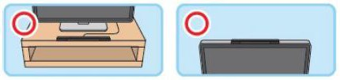

# dbar4gun 1.0.0rc1

[English](README.md) | Español

dbar4gun es un driver de Linux en espacio de usuario para el Wiimote, con soporte para la DolphinBar, pensado para funcionar como 4 light guns.

[](https://ko-fi.com/lowlevel1989)

Si quieres que este driver siga recibiendo actualizaciones y soporte lo más rápido posible, puedes apoyar el proyecto invitándome a un café ☕ para ayudar a que siga adelante.

## Recomendación

Recomendamos usar la DolphinBar como mando principal: en el modo 4, la barra se queda encendida hasta que apagamos el Wiimote. Así no hace falta conectar y desconectar el USB a mano cada vez que queremos jugar con el Wiimote.

Es importante apagar el Wiimote con el botón de encendido al terminar de jugar, para alargar la vida de los LEDs infrarrojos.

***para más precisión, pon la sensor bar encima de la pantalla***

## Funciones

- DolphinBar solo en modo 4
- N Mayflash DolphinBar
- 4 Wiimotes por DolphinBar (muy rápido con una sola barra)
- Bluetooth
- Wiimote con botones independientes
- multijugador
- Nunchuk
- tilt correction
- distance compensation
- calibración de dos, tres (por defecto) y cuatro puntos
- calibración guardada por Wiimote
- area profiles (full, 4:3, custom) por juego
- calibrator visual (pygame) con hardware check
- socket de control y comandos de CLI
- configuración estándar de la sensor bar de Wii
- LED del Wiimote -> mouse index
- teclas automáticas
- systemd
- cursor suavizado (One Euro)
- configuración IR como componente
- calibración como componente
- Wiimote genérico
- funciona en Linux
- funciona en RetroPie
- funciona en Raspbian



| dispositivo | botón     | mapeo           | solo cursor          | compartido   | por defecto en MAME               |
|-------------|-----------|-----------------|----------------------|--------------|-----------------------------------|
| wiimote     | ir        | cursor del ratón| igual                | false        | cursor                            |
| wiimote     | a         | tecla automática| btn a    (Bluetooth) | false        | bomba                             |
| wiimote     | b         | botón izquierdo | igual                | false        | gatillo                           |
| wiimote     | home      | tecla enter     | btn home (Bluetooth) | true / false | select                            |
| wiimote     | 1         | botón central   | btn 1    (Bluetooth) | false        |                                   |
| wiimote     | 2         | botón derecho   | btn 2    (Bluetooth) | false        | recargar (retroarch)              |
| wiimote     | plus      | tecla automática| key next (Bluetooth) | false / true | start                             |
| wiimote     | minus     | tecla automática| key prev (Bluetooth) | false / true | 1 moneda                          |
| wiimote     | d-pad     | tecla automática| flechas  (Bluetooth) | false / true | dirección                         |
| nunchuk     | stick     | d-pad del wiimote | abs hat (Bluetooth) | false       | dirección                         |
| nunchuk     | z         | tecla automática| btn z    (Bluetooth) | false        |                                   |
| nunchuk     | c         | tecla automática| btn c    (Bluetooth) | false        |                                   |
| combo       | b + home  | tecla tab       | igual                | true         | menú (mame, flycast)              |
| combo       | b + plus  |                 | igual                | false        | desactivar/activar IR (útil en la GUI) |
| combo       | b + minus | tecla esc       | igual                | true         | salir (retroarch)                 |
| combo       | b + 1     | tecla espacio   | igual                | true         | avance rápido                     |
| combo       | b + 2     | tecla 2         | igual                | true         | start (P2)                        |
| combo       | a + home  | tecla f1        | igual                | true         | menú (retroarch)                  |
| combo       | a + plus  |                 | igual                | false        | calibración (recalibración rápida de 2 puntos si ya está calibrado) |
| combo       | a + minus |                 | igual                | false        | borrar la calibración (vuelve al mapa sin calibrar) |


## Problemas conocidos

### 1. Fallo de los LEDs IR de la DolphinBar

**Problema:** la DolphinBar tiene LEDs infrarrojos que se pueden quemar con facilidad, y entonces no se puede apuntar bien.  
**Solución:** cambia los LEDs dañados o cambia la barra por una nueva. Las *IR diagnostics* del calibrator muestran cada dot; con `--experimental-ir-extended` también muestran su tamaño (un LED débil se ve más pequeño).

### 2. Puedo mover el puntero, pero no disparar

**Problema:** si puedes mover el puntero pero no disparar, puede que el driver esté detectando un teclado o un ratón como segunda light gun.  
**Solución:** cambia el "mouse index" en los ajustes del emulador para que coincida con el de la light gun y evitar conflictos. La pantalla *Players and buttons* del calibrator muestra la relación LED → VirtualGun → mouse index y las teclas que envía cada botón.

~~~
LED 1 del wiimote  -> mouse index 0 (y 4, 8...)
LED 2 del wiimote  -> mouse index 1
LED 3 del wiimote  -> mouse index 2
LED 4 del wiimote  -> mouse index 3
~~~

El LED muestra el mouse index tal como RetroArch numera los ratones (udev):
cuentan todos los ratones del sistema, en el orden de libudev. Las teclas de
cada pistola son las del jugador con ese mouse index, así que en RetroArch la
pistola funciona para ese jugador sin cambiar nada. El índice se comprueba cada
3 segundos: si se conecta o se quita un ratón, el LED y las teclas lo siguen.
Un Wiimote conectado por Bluetooth conserva su VirtualGun (y su lugar en la
lista) cuando se desconecta y vuelve.

Cuando el driver toma un Wiimote (y cada vez que se reconecta), el Wiimote
vibra un momento y sus LEDs hacen un barrido 1-2-3-4-todos antes de mostrar su
LED. La DolphinBar solo enciende un LED fijo, así que el barrido indica que el
driver ya lo tiene.

### 3. El puntero se vuelve inestable sin motivo aparente

**Problema:** el puntero se mueve de forma errática sin motivo aparente.  
**Causa posible:** la luz del sol, una lámpara o un reflejo interfieren con el sensor infrarrojo.  
**Solución:** compruébalo con las *IR diagnostics* del calibrator (las fuentes IR de más se dibujan en rojo). Ahora los reflejos y otras fuentes se suelen ignorar; si no, prueba otro nivel de `--ir-sensitivity`.

### 4. Problemas de calibración

**Problema:** cuesta calibrar bien el Wiimote.  
**Causas posibles y soluciones:**
- Dos rumbles cortos: se rechazó la captura (pulso inestable o la barra no se veía). Quédate quieto y vuelve a disparar.
- Estás demasiado cerca de la TV: la parte baja de la pantalla queda fuera del alcance de la cámara. Haz el *Reach test* del calibrator; te dice cuánto alejarte.
- Si usas la DolphinBar, puede que uno de sus LEDs IR esté dañado (ver 1).

### 5. El crosshair no llega a los bordes del juego

**Problema:** en juegos 4:3 sobre una TV 16:9, el rango de la pistola cubre toda la TV.  
**Solución:** con RetroArch (cores `lr-*`) usa el perfil `full`: RetroArch ya lleva la pistola a la imagen del juego. Con un emulador standalone que estira el rango de la pistola sobre la imagen, usa el area profile `4:3` (`dbar4gun area 4:3`, la opción `--area` o por juego en `profiles.cfg`).

## Calibración

Calibra desde donde juegas. La calibración se guarda por Wiimote (MAC de
Bluetooth o slot de la DolphinBar) en `calibration.json` y se carga cada vez que
arranca el driver. Durante la calibración, el crosshair del juego muestra el
target; un rumble corto confirma cada captura y dos rumbles cortos indican que
se rechazó (repite ese punto).

Lo más fácil es el calibrator visual (*Ports → dbar4gun calibrator*
o `dbar4gun gui`): adapta los targets a tu alcance, muestra la estabilidad de tu
pulso, comprueba el resultado y te deja calibrar a todos los jugadores seguidos.

Desde el juego:

### modo 2 (por defecto): 3 puntos
- **A + plus** (LED 1): dispara al target de **arriba a la izquierda**.
- LED 4: dispara al target de **arriba a la derecha**.
- LEDs 2 y 3: dispara al target de **abajo en el centro** (a la altura de la useful zone).

Una vez calibrado, **A + plus** hace una recalibración rápida de 2 puntos
(arriba a la izquierda y arriba a la derecha; las esquinas de abajo si la barra
está debajo de la TV). Es útil si se movió la barra. **A + minus** vuelve al
mapa sin calibrar; el siguiente **A + plus** hace la calibración completa.

### modo 1: 2 puntos
- **A + plus** (LEDs 2 y 3): dispara al **centro**.
- LED 1: dispara al target de **arriba a la izquierda**.

### modo 3: 4 puntos (homography)
- **A + plus**: dispara a los targets de arriba a la izquierda (LED 1), arriba a
  la derecha (LED 4), abajo a la derecha (LEDs 3+4) y abajo a la izquierda (LEDs
  1+2). Más preciso en las esquinas y cuando no te sientas delante de la TV.

### modo 0: desactivada

## Manual de configuración de light guns para cores concretos
Consulta el [README específico de configuración de light guns](retroarch) para ver cómo configurar los juegos en RetroArch.

## Juegos sin crosshair que funcionan perfectamente con el Wiimote (probados)

| juego                    | ROM / disco                    | emulador (RetroPie)  | resolución | smoothing level | nota                       |
|--------------------------|--------------------------------|----------------------|------------|-----------------|----------------------------|
| Operation Wolf           | `opwolf`                       | lr-mame              | 320x240    |  0              |                            |
| Point Blank              | `ptblank`                      | lr-mame              | 288x224    |  0              |                            |
| Point Blank 2            | `ptblank2`                     | lr-mame              | 320x240    |  0              |                            |
| Point Blank 3            | `ptblank3`                     | lr-mame              | 320x240    |  0              |                            |
| Ghoul Panic              | `ghlpanic`                     | lr-mame              | 512x480    |  0              |                            |
| Time Crisis              | `timecris`                     | lr-mame              | 640x480    |  0              |                            |
| Golly! Ghost!            | `gollygho`                     | lr-mame              | 288x224    |  0              |                            |
| VS. Hogan's Alley        | `hogalley`                     | lr-mame              | 256x240    |  0              | poca precisión en el bonus |
| Lucky & Wild             | `luckywld`                     | lr-mame2015          | 288x224    |  0              |                            |
| Area 51                  | `area51`                       | lr-mame2003-plus     | 320x240    |  0              |                            |
| House of the Dead 2      | `House of the Dead 2, The (USA).gdi` | flycast (standalone) | 640x480    |  0              |                            |
| Virtua Cop 2             | `Virtua Cop 2 (Japan).gdi`     | lr-flycast           | 640x480    |  0              |                            |

Cómo se probaron: RetroPie en una Raspberry Pi 5 (Debian 12), RetroArch 1.19.1,
dbar4gun 0.18.2 con `--smoothing-level 0`, cada juego con el emulador de la
tabla. Opciones de pistola de los cores: `mame_current_xy_type = "lightgun"` (lr-mame),
`mame2003-plus_xy_device = "lightgun"`, `mame2015_mouse_mode = "lightgun"`.

## Consumo de memoria de dbar4gun

Ahora mismo dbar4gun consume ~24 MB. Cada Wiimote conectado por Bluetooth suma ~19 MB más, porque se crea un proceso dedicado para gestionar cada Wiimote.

En el caso de la DolphinBar, se detecta como cuatro Wiimotes aunque no estén conectados, lo que suma ~76 MB.

### Resumen del consumo de memoria

| Elemento                              | Consumo de memoria |
|---------------------------------------|--------------------|
| dbar4gun                              | ~24 MB             |
| monitor                               | ~19 MB             |
| Por cada Wiimote por Bluetooth        | ~19 MB             |
| DolphinBar (detectada como 4 Wiimotes)| ~76 MB             |

Si ya conoces la dirección de tu(s) Wiimote(s) (por ejemplo `/dev/hidraw0`), puedes conectarlo directamente con el subcomando `attach`. En ese caso no hace falta el monitor y el consumo de memoria baja muchísimo.

| Elemento                              | Consumo de memoria |
|---------------------------------------|--------------------|
| dbar4gun attach                       | ~24 MB             |

## Area profiles

Con RetroArch (todos los cores `lr-*`) deja `full`: RetroArch ya lleva la
posición de la pistola a la imagen del juego (también un juego 4:3 en una TV
16:9), y apuntar fuera de la imagen es "offscreen", para recargar. Un emulador
standalone que estira el rango de la pistola sobre la imagen del juego necesita
el aspecto del juego (`4:3`).

- Perfil por defecto: `--area full|4:3|custom:x0,y0,w,h` (RetroPie-Setup →
  dbar4gun → *default area profile*).
- Por juego: `profiles.cfg` en el directorio de configuración
  (`/opt/retropie/configs/all/dbar4gun/` en RetroPie). Prioridad: `rom:<nombre>`
  > `system/emulator` > `emulator` > `system` > `default`. Los hooks de
  runcommand de RetroPie lo aplican al empezar un juego y vuelven al de por
  defecto al terminar.
- En vivo: `dbar4gun area 4:3`, o la pantalla *Area profile* del calibrator.
- **Useful zone** (`--useful-zone 0.85`): la parte de la altura de la pantalla
  con targets (la parte de abajo suele ser el HUD). La usan la calibración y el
  reach test.

## Comandos de control

Hablan con el servicio en marcha a través de `/run/dbar4gun.sock` y no necesitan root.

```
dbar4gun status                 # Wiimotes, batería, Hz, calibración, distancia (JSON)
dbar4gun area 4:3               # area profile ahora
dbar4gun calibrate [2] [--quick]
dbar4gun cancel
dbar4gun reload                 # relee las calibraciones guardadas y hardware.json
dbar4gun hw [fov 38.5] [acc_x_sign -1] [bar_width 0.20] [ir_sensitivity 4|default]   # valores medidos del hardware
dbar4gun check --area 4:3 --useful-zone 0.85   # valida valores de opciones (sin daemon)
dbar4gun profile start <system> <emulator> [rom]   # lo usan los hooks de runcommand
dbar4gun hooks install|uninstall
```

El protocolo (también el paquete UDP del calibrator) está en [docs/PROTOCOL.md](docs/PROTOCOL.md).
Linux de escritorio: [docs/PLATFORMS.md](docs/PLATFORMS.md).

## Desarrollo

`tests/` funciona sin Wiimote: `tests/sim/` simula la cámara IR (TV, sensor
bar, posición del jugador y dónde apunta) y mide el error en una rejilla de 7x7.

```
pip install .[gui] pytest
SDL_VIDEODRIVER=dummy python -m pytest -s
```

Los scripts de prueba de hardware antiguos están en `tools/`.

## Pendiente

1. ir setup en diamante
2. ir setup en cuadrado

## Instalar con RetroPie-Setup

### Descargar el instalador de dbar4gun

```
cd ~/RetroPie-Setup/scriptmodules/supplementary
curl -LO https://raw.githubusercontent.com/lowlevel-1989/dbar4gun/1.0.0rc/retropie/dbar4gun.sh
```

### Abrir RetroPie-Setup

```
*Manage packages \~ driver \~ dbar4gun \~ Install*  
```

### Arrancar el servicio

```
*Manage packages \~ driver \~ dbar4gun \~ Configuration \~ Enable/Restart dbar4gun*  
```

### Parar el servicio
```
*Manage packages \~ driver \~ dbar4gun \~ Configuration \~ Disable dbar4gun*  
```

### Estado del servicio
```
systemctl status dbar4gun
```

### Bluetooth

Si tienes una Raspberry Pi 2 o anterior, necesitas un dongle Bluetooth (a veces llamado adaptador Bluetooth). Para ver una lista de dongles que funcionan con la Raspberry Pi, consulta [https://elinux.org/RPi_USB_Bluetooth_adapters#Working_Bluetooth_adapters](https://elinux.org/RPi_USB_Bluetooth_adapters#Working_Bluetooth_adapters).

[adding-a-bluetooth-controller-to-retropie](https://retropie.org.uk/docs/Bluetooth-Controller/#adding-a-bluetooth-controller-to-retropie)

## Instalar a mano

### Dependencias del sistema

- git
- python >= 3.7
- bluez >= 5.0

### Dependencias de Python

- evdev>=0.3.0
- pyudev>=0.16
- pygame (solo para el calibrator, `pip install .[gui]`)

### Pasos como root

#### build

```
cd dbar4gun
python -m venv $(pwd)
source $(pwd)/bin/activate
pip install $(pwd)
```

### Uso

#### ayuda del servicio
```
dbar4gun start --help
```

| opción | por defecto | |
|---|---|---|
| `--calibration {0,1,2,3}` | 2 | 0 desactivada, 1 centro + arriba a la izquierda, 2 tres puntos, 3 cuatro puntos (homography) |
| `--setup {1}` | 1 | IR setup: sensor bar estándar / DolphinBar |
| `--width`, `--height` | 1920, 1080 | tamaño de la pantalla (rango ABS de la pistola) |
| `--disable-tilt-correction` | | |
| `--no-distance-compensation` | | entonces la precisión depende de mantener la distancia de la calibración |
| `--smoothing-level N` | 3 | filtro One Euro: 0 desactivado, más alto = más suave |
| `--area` | full | `full`, `4:3`, `custom:x0,y0,w,h` |
| `--useful-zone` | 0.85 | fracción de la altura de la pantalla con targets |
| `--bar {top,bottom}` | top | posición de la sensor bar |
| `--calibration-targets x1,y1,x2,y2,x3,y3` | | targets de 3 puntos en el espacio de la pistola |
| `--ir-sensitivity {1..5,marcan,cliff}` | marcan | sensibilidad de la cámara IR (niveles de wiibrew) |
| `--config-dir` | según la plataforma | calibraciones y `profiles.cfg` |
| `--socket` | /run/dbar4gun.sock | socket de control |
| `--port` | 35460 | puerto UDP para el calibrator |
| `--log-level` | info | |
| `--single-process` | | experimental: un solo proceso para todos los Wiimotes |
| `--experimental-ir-extended` | | permite el modo IR extendido (tamaño de los dots) |

#### arrancar el servicio como root
```
dbar4gun start --width 1920 --height 1080
```

#### reiniciar el servicio como root

```
dbar4gun start --width 1920 --height 1080
```

#### ver la versión

```
dbar4gun version
```

#### calibrator visual (necesita pygame: `pip install .[gui]`)
```
dbar4gun gui              # pantalla completa, solo con el Wiimote (Home para salir)
dbar4gun gui --windowed --width 1280 --height 720
dbar4gun gui --lang es    # en español
```

#### parar el servicio como root

```
dbar4gun stop
```

#### conectar un dispositivo como root

```
dbar4gun attach /dev/hidraw0
```

### Bluetooth

Pulsa el botón SYNC rojo del Wiimote (debajo de la tapa de las pilas) y lanza
enseguida:

~~~
bluez/pair-wiimote.sh
~~~

Encuentra solo el Wiimote en modo SYNC (no hace falta saber su MAC), lo empareja
con `bluez/simple-agent` (si pide un PIN, pulsa Enter sin escribir nada) y lo
marca como de confianza, así que a partir de ahí se reconecta al pulsar
cualquier botón. Empareja cada Wiimote igual, de uno en uno.

Los mismos pasos a mano (la mayoría de distribuciones ya no traen `hcitool`),
con la MAC que muestra el scan para `Nintendo RVL-CNT-01`:

~~~
sudo -v
bluetoothctl --timeout 20 scan on & sleep 6; sudo python3 bluez/simple-agent -c DisplayYesNo hci0 XX:XX:XX:XX:XX:XX
bluetoothctl trust XX:XX:XX:XX:XX:XX
~~~

Si tienes problemas para volver a emparejar el Wiimote por Bluetooth, bórralo y
repite los pasos anteriores:

~~~
bluetoothctl remove XX:XX:XX:XX:XX:XX
~~~

## Referencias

El formato de los reports del Wiimote no es público y hubo que hacer ingeniería inversa. Estos recursos fueron muy útiles para crear dbar4gun:

- [https://www.wiibrew.org/wiki/Wiimote](https://www.wiibrew.org/wiki/Wiimote)
- [https://github.com/xwiimote/xwiimote/blob/master/doc/PROTOCOL](https://github.com/xwiimote/xwiimote/blob/master/doc/PROTOCOL)
