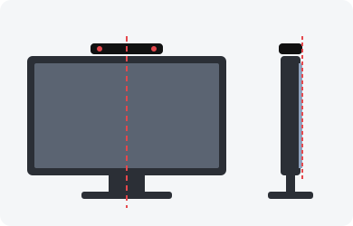

# dbar4gun 1.2.0

English | [Español](README.es.md)

dbar4gun is a Linux userspace driver for the wiimote with DolphinBar support, specifically designed to function as 4 light guns.

[](https://ko-fi.com/lowlevel1989)

If you'd like to see updates and active support for this driver continue as quickly as possible, consider supporting the project — you can buy me a coffee ☕ to help keep things running!

## Install

- **RetroPie**: [retropie/README.md](retropie/README.md)
- **Other Linux** (desktop, Raspbian...): [docs/install-linux.md](docs/install-linux.md)

Then calibrate from where you play: [docs/calibration.md](docs/calibration.md).

## Before playing: RetroArch

dbar4gun sends the MAME default keys, and some of them are also RetroArch hotkeys
(`f` is fullscreen, `l` is fast forward...): with 2 or more guns they would clash.
Turn them off only for the light gun games by adding these lines to
`/opt/retropie/configs/lightgun/retroarch.cfg`, above the `#include` line:

```
input_toggle_fullscreen = "nul"
input_hold_fast_forward = "nul"
input_frame_advance = "nul"
input_netplay_game_watch = "nul"
```

If your light gun emulators load another file (`--config ...` in
`/opt/retropie/configs/lightgun/emulators.cfg`), put the lines in that file.
Details: [docs/mapping.md](docs/mapping.md).

## Buttons

| device   | button    | map           | only cursor          | shared        | mame default                      |
|----------|-----------|---------------|----------------------|---------------|-----------------------------------|
| wiimote  | ir        | mouse cursor  | same                 | false         | cursor                            |
| wiimote  | a         | auto key      | btn a    (Bluetooth) | false         | bomb                              |
| wiimote  | b         | mouse left    | same                 | false         | trigger                           |
| wiimote  | home      | key enter     | btn home (Bluetooth) | true / false  | select                            |
| wiimote  | 1         | mouse middle  | btn 1    (Bluetooth) | false         |                                   |
| wiimote  | 2         | mouse right   | btn 2    (Bluetooth) | false         | reload (retroarch)                |
| wiimote  | plus      | auto key      | key next (Bluetooth) | false / true  | start                             |
| wiimote  | minus     | auto key      | key prev (Bluetooth) | false / true  | 1 coin                            |
| wiimote  | d-pad     | auto key      | arrows   (Bluetooth) | false / true  | direction                         |
| nunchuck | stick     | wiimote d-pad | abs hat  (Bluetooth) | false         | direction                         |
| nunchuck | z         | auto key      | btn z    (Bluetooth) | false         | MAME: assign `key b` to button 2 ([or copy default.cfg](retroarch/mame)) |
| nunchuck | c         | auto key      | btn c    (Bluetooth) | false         |                                   |
| combo    | b + home  | key tab       | same                 | true          | menu (mame,flycast)               |
| combo    | b + plus  |               | same                 | false         | disable/enable ir (useful in gui) |
| combo    | b + minus | key esc       | same                 | true          | exit (retroarch)                  |
| combo    | b + 1     | key space     | same                 | true          | fast forward                      |
| combo    | b + 2     | key 2         | same                 | true          | start (P2)                        |
| combo    | a + home  | key f1        | same                 | true          | menu (retroarch)                  |
| combo    | a + plus  |               | same                 | false         | calibration (quick 2-point recalibration if already calibrated) |
| combo    | a + minus |               | same                 | false         | reset calibration (back to the uncalibrated map) |

Full map with the key of each gun, what it does in MAME and in RetroArch, and the
clashes with RetroArch: [docs/mapping.md](docs/mapping.md).

## Recommendation

We recommend using DolphinBar as the main controller because, in mode 4, the bar stays on until we turn off the Wiimote. This way, we avoid having to manually connect or disconnect the USB every time we want to play with the Wiimote.

It is important to remember to disconnect the Wiimote using the power button at the end of playing to increase the lifespan of the infrared LEDs.



Where to put the sensor bar:

- **on top of the TV**, not below it;
- **in the middle** of the TV;
- **at the front edge** of the screen.

### Why on top, and how far away to play

The Wiimote has a small camera at its front. To know where you are aiming, the
camera has to see the sensor bar, and it only sees about 15° above and below
the point you aim at (it depends on the Wiimote). So the further that point is
from the bar, the further back you have to be.

For example, a 65" TV is about 81 cm tall. From 2 m, the camera only sees the
bar while you aim up to about 55 cm below it: about two thirds of the screen.
Lower than that, the Wiimote no longer knows where you are aiming.

How much of the screen height you reach, by TV and distance (approximately):

| TV  | 1.5 m | 2 m  | 2.5 m | 3 m  |
|-----|-------|------|-------|------|
| 32" | 95%   | 100% | 100%  | 100% |
| 43" | 71%   | 96%  | 100%  | 100% |
| 55" | 55%   | 75%  | 95%   | 100% |
| 65" | 47%   | 64%  | 81%   | 97%  |
| 75" | 41%   | 55%  | 70%   | 84%  |

Calculated with a Wiimote that sees 40° (horizontal FOV), to be on the safe
side. Many see a bit more: with 43° you reach about 8% more (a 55" TV from 2 m:
about 82%). The hardware check of the calibrator measures the FOV of yours.

**It does not matter if you cannot reach the very bottom.** Games almost never
put targets at the bottom of the screen: it usually has the HUD (lives,
score...) or just decoration. That is why the calibration only goes down to
the **useful zone**: 85% of the height by default. It has to be lower than
what you reach:

- you reach 90% or more: keep the useful zone at 85%;
- you reach less: move back, or set the useful zone about 5% lower than what
  you reach (RetroPie: options menu → *useful zone*).

That is why the bar goes on top: if you cannot sit far enough, you only lose
that bottom part, which almost no game uses. With the bar below the TV you
would lose the top, where games put most of their targets.

**Small TV:** if you cannot put the bar on top, below also works as long as you
reach the whole screen (a 32" TV from 2 m, a 43" TV from 2.5 m). Keep the
useful zone at 85% and check the top of the screen with the shooting gallery.

Each Wiimote sees a bit differently. The *Reach test* of the calibrator
measures yours with your TV and tells you how far to move back.

## Feature support

- Only DolphinBar in mode 4
- N Mayflash Dolphinbar
- 4 wiimote x Dolphinbar (very fast with a single bar)
- Bluetooth
- wiimote with individual buttons
- multiplayer
- nunchuck
- tilt correction
- distance compensation
- calibration two, three (default) and four points
- calibration saved per Wiimote
- area profiles (full, 4:3, custom) per game
- visual calibrator (pygame) with hardware check
- control socket and CLI commands
- Standard configuration for Wii sensor
- wiimote led -> index mouse
- auto key: each gun sends the MAME default keys of its player, so games are comfortable to play without mapping the buttons ([button map](docs/mapping.md)); the exceptions are in [retroarch](retroarch)
- systemd
- Smoothed cursor (One Euro)
- Generic wiimote
- works on linux
- works on retropie
- works on raspbian

## Documentation

| | |
|---|---|
| [Calibration](docs/calibration.md) | calibrate with the calibrator or from the game |
| [Button map](docs/mapping.md) | the key of each gun, MAME and RetroArch |
| [Tested games](docs/games.md) | games, emulators, and Point Blank 3 on a Raspberry Pi 5 |
| [Per-game configs](retroarch) | RetroArch and MAME configs of some games |
| [Area profiles](docs/area-profiles.md) | only for emulators that stretch the gun over the image |
| [Options and commands](docs/usage.md) | service options, control commands, memory |
| [Known issues](docs/troubleshooting.md) | IR LEDs, can't shoot, unstable pointer, calibration |
| [lr-mame for the Raspberry Pi 5](docs/lr-mame-pi5.md) | build a faster lr-mame for Point Blank 2/3 |
| [Development](docs/development.md) | tests with the simulator, references |
| [Code](dbar4gun/README.md) | what each folder and file of the code does |
| [Protocol](docs/PROTOCOL.md) | control socket and UDP packet |
