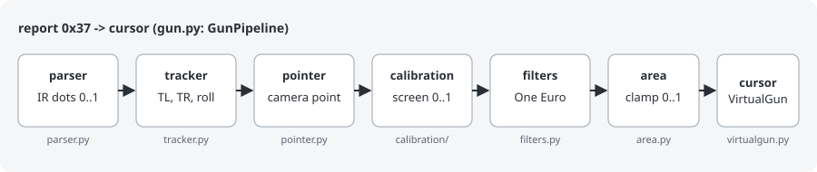
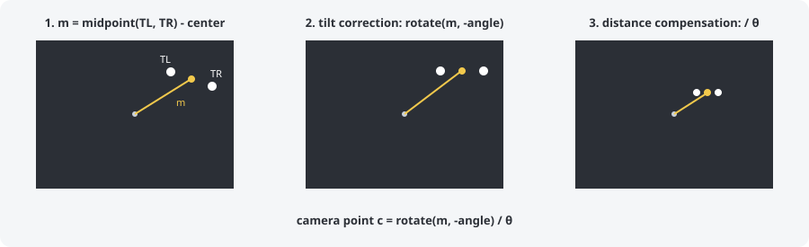
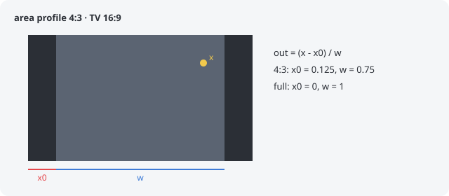

# core

[English](README.md) | Español

El pipeline de un Wiimote: de cada report (botones, acelerómetro y dots IR) al
cursor de su VirtualGun. Aquí no hay I/O, así que cada paso se puede probar con
el simulador (`tests/sim/`). `gun.py` une los pasos.

| archivo        | de qué se encarga                                                     |
|----------------|-----------------------------------------------------------------------|
| `gun.py`       | `GunPipeline`: el pipeline completo y los botones de calibración (A + plus...) |
| `parser.py`    | lee los dots IR de un report; la x va invertida (apuntar a la derecha -> x crece) |
| `tracker.py`   | sigue los 2 dots de la barra (TL, TR), reconstruye un dot perdido, roll del acelerómetro |
| `pointer.py`   | camera point: a dónde apunta el Wiimote, sin roll ni distancia       |
| `calibration/` | de camera point a la pantalla ([README](calibration/README.es.md))    |
| `filters.py`   | filtro One Euro: suaviza el cursor sin retraso al moverse rápido      |
| `area.py`      | area profile: la parte de la TV que usa la imagen del juego           |
| `hardware.py`  | valores medidos con el hardware check (`hardware.json`)               |
| `feedback.py`  | rumble sin bloquear el bucle                                          |

## Camera point

El tracker trabaja en "espacio cuadrado" (`y * 767/1023`), para que las
distancias y los ángulos no dependan de la forma del sensor. El camera point es
el punto medio de los dos dots, medido desde el centro del sensor, y después se
corrige:

- **Tilt correction**: el punto medio se gira con el ángulo de TL -> TR, así
  que inclinar el Wiimote no mueve el cursor.
- **Distance compensation**: se divide entre θ, el ángulo entre los dos dots
  visto desde la cámara. Cuanto más lejos, menor es θ y más corto el punto
  medio, así que el resultado no cambia. Se usa θ (y no la distancia entre los
  dots en la imagen) porque la distancia en la imagen crece al apuntar lejos de
  la barra, y eso deformaba las esquinas.

Después, la calibración convierte el camera point en un punto de la pantalla:
[calibration/README.es.md](calibration/README.es.md).

## Area profile

