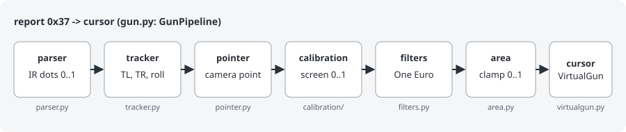
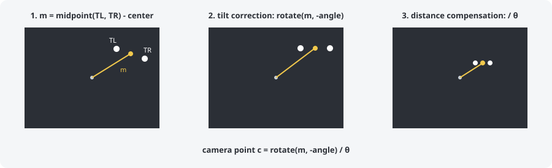
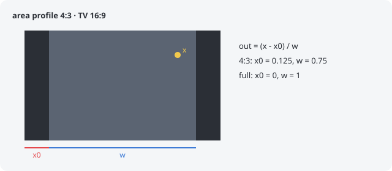

# core

English | [Español](README.es.md)

The pipeline of one Wiimote: from each report (buttons, accelerometer and IR
dots) to the cursor of its VirtualGun. There is no I/O here, so every step can
be tested with the simulator (`tests/sim/`). `gun.py` joins the steps.

| file           | what it does                                                          |
|----------------|-----------------------------------------------------------------------|
| `gun.py`       | `GunPipeline`: the whole pipeline, and the calibration buttons (A + plus...) |
| `parser.py`    | reads the IR dots of a report; x is inverted (aim right -> x grows)   |
| `tracker.py`   | follows the 2 dots of the bar (TL, TR), rebuilds a lost dot, roll from the accelerometer |
| `pointer.py`   | camera point: where the Wiimote points, without roll and distance    |
| `calibration/` | from camera point to the screen ([README](calibration/README.md))     |
| `filters.py`   | One Euro filter: smooths the cursor without lag when moving fast      |
| `area.py`      | area profile: the part of the TV that the game image uses             |
| `hardware.py`  | values measured with the hardware check (`hardware.json`)             |
| `feedback.py`  | rumble without blocking the loop                                      |

## Camera point

The tracker works in "square space" (`y * 767/1023`), so distances and angles
do not depend on the shape of the sensor. The camera point is the midpoint of
the two dots, measured from the center of the sensor, then corrected:

- **Tilt correction**: the midpoint is rotated by the angle of TL -> TR, so
  tilting the Wiimote does not move the cursor.
- **Distance compensation**: it is divided by θ, the angle between the two
  dots seen from the camera. The further away, the smaller θ and the shorter
  the midpoint, so the result does not change. θ (and not the distance between
  the dots in the image) because the image distance grows when aiming far from
  the bar, and that bent the corners.

The calibration then turns the camera point into a point on the screen:
[calibration/README.md](calibration/README.md).

## Area profile

