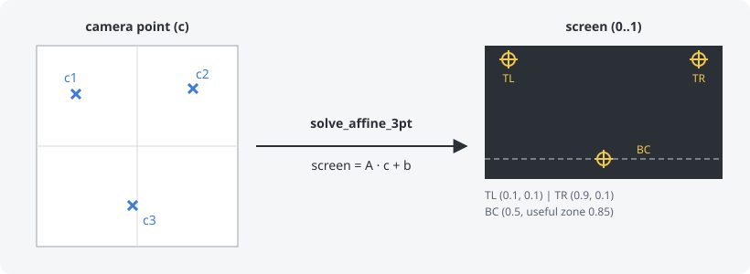
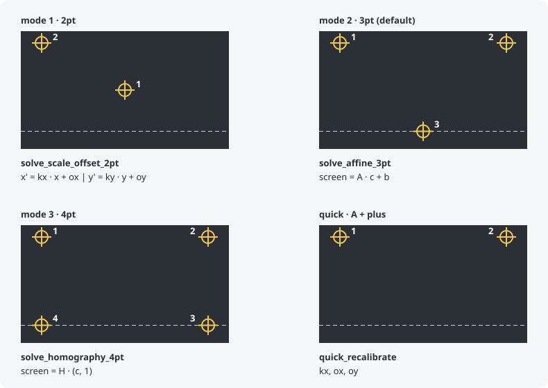
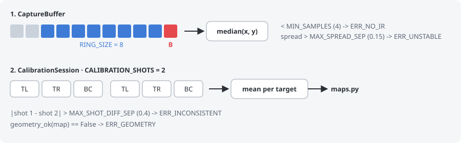

# core/calibration

[English](README.md) | Español

La calibración convierte el camera point (a dónde apunta el Wiimote, medido
desde la barra: [core/README.es.md](../README.es.md#camera-point)) en un punto de
la pantalla. Los puntos de pantalla van de 0 a 1 sobre toda la TV, con la y
hacia abajo. El cursor solo se limita a la pantalla al final del pipeline
(`core/gun.py`).

| archivo      | de qué se encarga                                                        |
|--------------|--------------------------------------------------------------------------|
| `session.py` | `CalibrationSession`: una calibración de principio a fin, target a target |
| `capture.py` | `CaptureBuffer`: el camera point de un disparo, o un error               |
| `maps.py`    | `AffineMap`, `HomographyMap` y las funciones que los calculan            |
| `data.py`    | `CalibrationData` (lo que se guarda), los modos y el mapa de antes de calibrar |

## Cómo se calcula una calibración

Ejemplo con el modo 2, el de por defecto:

- Izquierda: los camera points `c1`, `c2` y `c3` medidos cuando el jugador
  disparó a cada target.
- Derecha: dónde están esos targets en la pantalla (TL, TR y BC). La línea
  discontinua es la useful zone: por debajo, los juegos suelen tener el HUD y no
  ponen targets.
- `solve_affine_3pt` busca el mapa que lleva cada `c` exactamente a su target:
  `screen = A · c + b` tiene 6 incógnitas, y 3 puntos en 2 ejes dan 6
  ecuaciones.
- Desde entonces, cada report pasa por ese mapa. El resultado es un
  `CalibrationData`, que `store.py` guarda para cada Wiimote.

## Modos (`--calibration`)

Los números son el orden de los disparos. Los LEDs del Wiimote indican cuál es
el siguiente target (`_target_leds` en `core/gun.py`).

| modo | nombre          | targets (LEDs)                                       | mapa: qué corrige |
|------|-----------------|------------------------------------------------------|-------------------|
| 0    | `MODE_DISABLED` | ninguno                                              | mapa nominal: TV de 45", barra de 20 cm y el jugador a 3 m |
| 1    | `MODE_2PT`      | centro (2+3), arriba a la izquierda (1)              | `solve_scale_offset_2pt`: escala y offset de cada eje; sin giro |
| 2    | `MODE_3PT`      | arriba izquierda (1), arriba derecha (4), abajo centro (2+3) | `solve_affine_3pt`: escala, offset, giro e inclinación |
| 3    | `MODE_4PT`      | las 4 esquinas: TL (1), TR (4), BR (3+4), BL (1+2)   | `solve_homography_4pt`: también la perspectiva, para jugar desde un lado |

**Recalibración rápida**: ya calibrado, **A + plus** pide solo 2 disparos, en
las esquinas de arriba.
`quick_recalibrate` corrige la escala horizontal (`kx`) y los offsets (`ox`,
`oy`), y conserva la escala vertical y el giro de la calibración. Sirve para
cuando la barra se ha movido un poco.

## Cómo se toma un disparo

1. `CaptureBuffer` guarda los últimos frames con la barra a la vista
   (`RING_SIZE`, 8). Un frame sin IR lo vacía: la captura tiene que ser
   continua.
2. Al pulsar **B**, el disparo es la mediana de esos frames. El frame de B no
   cuenta, porque apretar el gatillo mueve el Wiimote.
3. `CalibrationSession` hace 2 vueltas a los targets (`CALIBRATION_SHOTS`).
   Cada vuelta es un apuntado nuevo, y los disparos al mismo target se
   promedian: un disparo algo desviado no mueve toda la calibración.
4. Con todos los targets hechos, `maps.py` calcula el mapa del modo.

## Errores de un disparo

| error              | archivo      | cuándo                                            | qué pasa |
|--------------------|--------------|---------------------------------------------------|----------|
| `ERR_NO_IR`        | `capture.py` | menos de 4 frames con la barra (`MIN_SAMPLES`)    | se vuelve a disparar |
| `ERR_UNSTABLE`     | `capture.py` | la mano se movió más de 0.15 separaciones de barra (`MAX_SPREAD_SEP`) | se vuelve a disparar |
| `ERR_INCONSISTENT` | `session.py` | dos disparos al mismo target separados más de 0.4 separaciones de barra (`MAX_SHOT_DIFF_SEP`) | se repiten los disparos de ese target |
| `ERR_GEOMETRY`     | `session.py` | el mapa no es válido: degenerado o con un eje invertido (`geometry_ok`) | la calibración empieza de nuevo |

El jugador lo sabe por el rumble: uno corto es un disparo bueno, dos cortos un
error.
