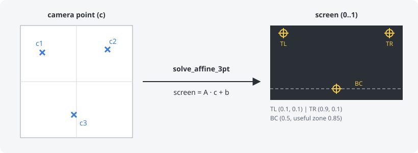
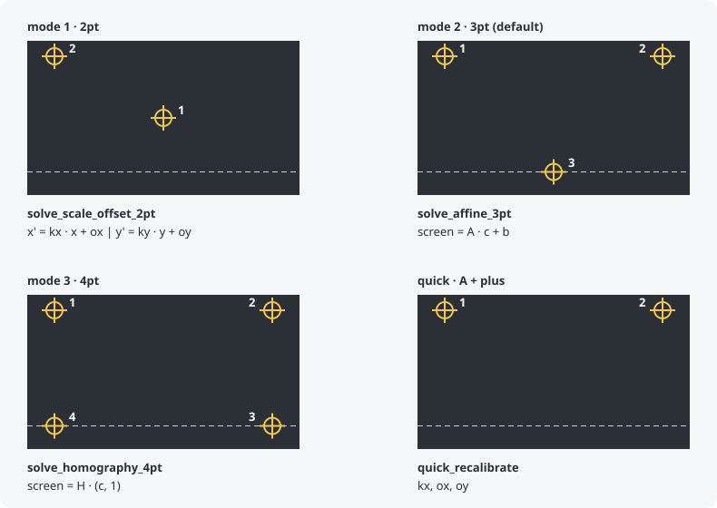
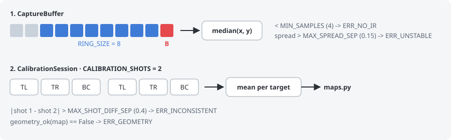

# core/calibration

English | [Español](README.es.md)

The calibration turns the camera point (where the Wiimote points, measured from
the sensor bar: [core/README.md](../README.md#camera-point)) into a point on the
screen. Screen points go from 0 to 1 over the whole TV, with y going down. The
cursor is only clamped to the screen at the end of the pipeline (`core/gun.py`).

| file         | what it does                                                             |
|--------------|--------------------------------------------------------------------------|
| `session.py` | `CalibrationSession`: one calibration from start to end, target by target |
| `capture.py` | `CaptureBuffer`: the camera point of one shot, or an error               |
| `maps.py`    | `AffineMap`, `HomographyMap` and the functions that calculate them       |
| `data.py`    | `CalibrationData` (what is saved), the modes and the map used before calibrating |

## How a calibration is calculated

Example with mode 2, the default one:

- Left: the camera points `c1`, `c2` and `c3` measured when the player shot at
  each target.
- Right: where those targets are on the screen (TL, TR and BC). The dashed line
  is the useful zone: below it games usually have their HUD and no targets.
- `solve_affine_3pt` finds the map that takes each `c` exactly to its target:
  `screen = A · c + b` has 6 unknowns, and 3 points on 2 axes give 6 equations.
- From then on, every report goes through that map. The result is a
  `CalibrationData`, which `store.py` saves for each Wiimote.

## Modes (`--calibration`)

The numbers are the order of the shots. The Wiimote LEDs show which target is
next (`_target_leds` in `core/gun.py`).

| mode | name            | targets (LEDs)                                   | map: what it corrects |
|------|-----------------|--------------------------------------------------|-----------------------|
| 0    | `MODE_DISABLED` | none                                             | nominal map: a 45" TV, a 20 cm bar and the player at 3 m |
| 1    | `MODE_2PT`      | center (2+3), top-left (1)                       | `solve_scale_offset_2pt`: scale and offset of each axis; no rotation |
| 2    | `MODE_3PT`      | top-left (1), top-right (4), bottom center (2+3) | `solve_affine_3pt`: scale, offset, rotation and shear |
| 3    | `MODE_4PT`      | the 4 corners: TL (1), TR (4), BR (3+4), BL (1+2) | `solve_homography_4pt`: also the perspective, for playing from a side |

**Quick recalibration**: once calibrated, **A + plus** asks for only 2 shots, at
the top corners. `quick_recalibrate`
corrects the horizontal scale (`kx`) and the offsets (`ox`, `oy`), and keeps the
vertical scale and the rotation of the calibration. It is for when the bar has
moved a little.

## How one shot is taken

1. `CaptureBuffer` keeps the last frames with the bar in sight (`RING_SIZE`,
   8). A frame without IR empties it: the capture must be continuous.
2. When **B** is pressed, the shot is the median of those frames. The frame of
   B itself does not count, because pulling the trigger moves the Wiimote.
3. `CalibrationSession` makes 2 rounds over the targets
   (`CALIBRATION_SHOTS`). Each round is a new aim, and the shots at the same
   target are averaged: a slightly wrong shot does not move the whole
   calibration.
4. With every target done, `maps.py` calculates the map of the mode.

## Errors of a shot

| error              | file         | when                                              | what happens |
|--------------------|--------------|---------------------------------------------------|--------------|
| `ERR_NO_IR`        | `capture.py` | fewer than 4 frames with the bar (`MIN_SAMPLES`)  | shoot again |
| `ERR_UNSTABLE`     | `capture.py` | the hand moved more than 0.15 bar separations (`MAX_SPREAD_SEP`) | shoot again |
| `ERR_INCONSISTENT` | `session.py` | two shots at the same target more than 0.4 bar separations apart (`MAX_SHOT_DIFF_SEP`) | the shots of that target are repeated |
| `ERR_GEOMETRY`     | `session.py` | the map is not valid: degenerate or with an inverted axis (`geometry_ok`) | the calibration starts again |

The player knows it by the rumble: a short one is a good shot, two short ones
an error.
