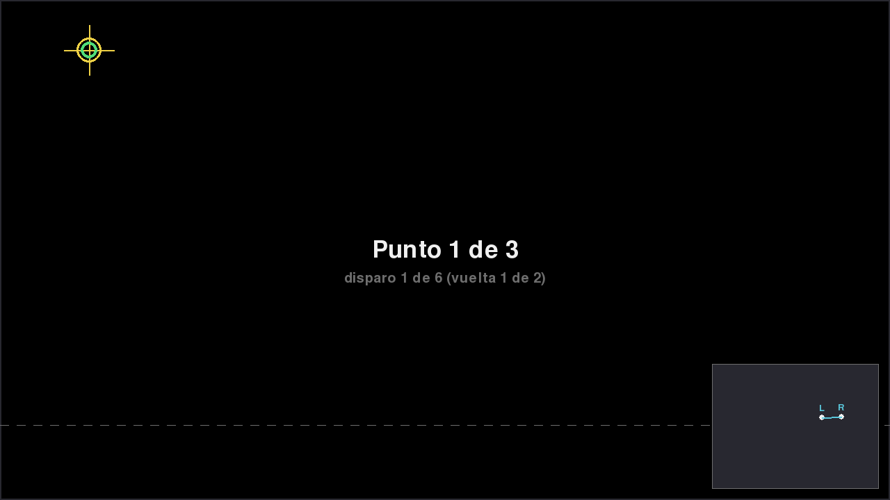
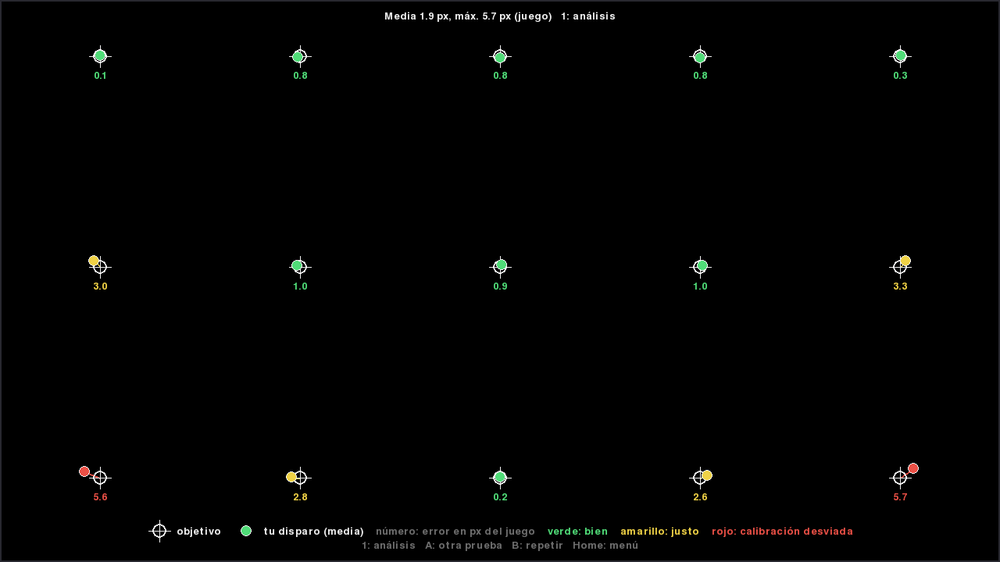

# Calibración

[English](calibration.md) | Español

Calibra desde donde juegas. La calibración se guarda por Wiimote (MAC de
Bluetooth o slot de la DolphinBar) en `calibration.json` y se carga cada vez que
arranca el driver. Durante la calibración, el crosshair del juego muestra el
target; un rumble corto confirma cada captura y dos rumbles cortos indican que
se rechazó (repite ese punto).

Lo más fácil es el calibrator visual (*Ports → dbar4gun calibrator*
o `dbar4gun gui`): adapta los targets a tu alcance, muestra la estabilidad de tu
pulso, comprueba el resultado y te deja calibrar a todos los jugadores seguidos.

## Con el calibrator, paso a paso

**1. Ábrelo** desde *Ports → dbar4gun calibrator* (o `dbar4gun gui`). Elige las
opciones con el Wiimote que quieres configurar: el que pulsa **A**.

**2. Comprobación de hardware** (la primera vez): revisa la conexión, la cámara
IR, el acelerómetro, el FOV, la barra y la reconexión. Verde está bien; si un
valor está mal, ofrece aplicar el medido.

**3. Calibrar**: dispara (**B**) a cada target. Hay 2 vueltas, y los disparos
al mismo target se promedian. Al final, dispara al centro para comprobar el
resultado.

**4. Compruébalo con la galería de tiro**: dispara a los targets y mira el
mapa. Verde está bien, amarillo es justo y rojo indica que la calibración está
desviada: vuelve a calibrar.

**Si un target no se alcanza** (normalmente el de abajo): la *Prueba de
alcance* te dice cuánto echarte atrás.

Para calibrar a otro jugador, vuelve al menú (**Home**) y elige *Calibrar* con
ese Wiimote.

## Desde el juego, sin el calibrator

### modo 2 (por defecto): 3 puntos
- **A + plus** (LED 1): dispara al target de **arriba a la izquierda**.
- LED 4: dispara al target de **arriba a la derecha**.
- LEDs 2 y 3: dispara al target de **abajo en el centro** (a la altura de la useful zone).

Una vez calibrado, **A + plus** hace una recalibración rápida de 2 puntos
(arriba a la izquierda y arriba a la derecha). Es útil si se movió la barra. **A + minus** vuelve al
mapa sin calibrar; el siguiente **A + plus** hace la calibración completa.

### modo 1: 2 puntos
- **A + plus** (LEDs 2 y 3): dispara al **centro**.
- LED 1: dispara al target de **arriba a la izquierda**.

### modo 3: 4 puntos (homography)
- **A + plus**: dispara a los targets de arriba a la izquierda (LED 1), arriba a
  la derecha (LED 4), abajo a la derecha (LEDs 3+4) y abajo a la izquierda (LEDs
  1+2). Más preciso en las esquinas y cuando no te sientas delante de la TV.

### modo 0: desactivada
