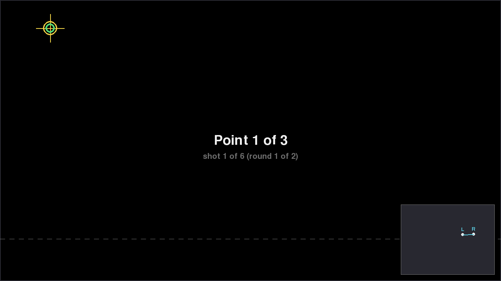
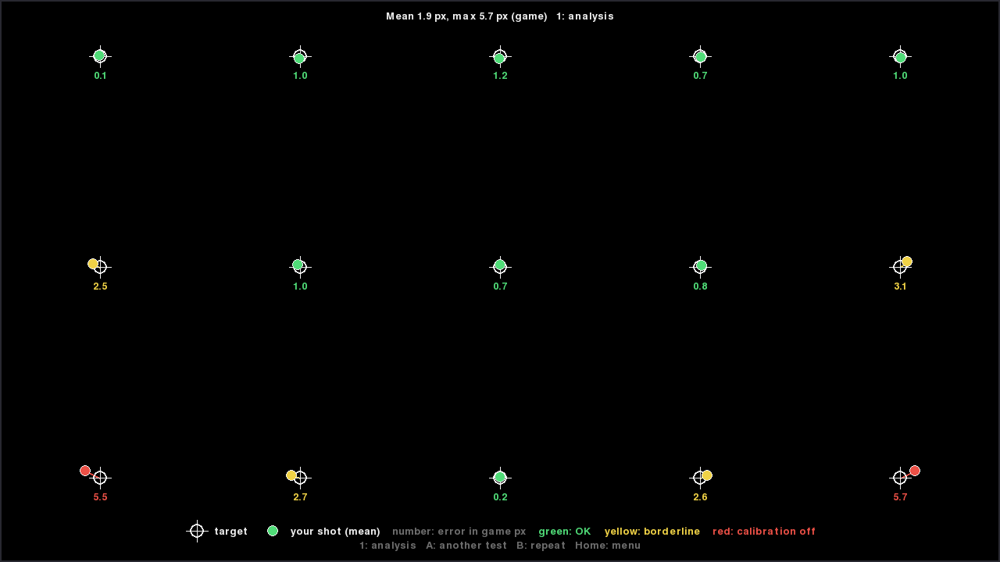

# Calibration

English | [Español](calibration.es.md)

Calibrate from where you play. The calibration is saved per Wiimote (Bluetooth
MAC or DolphinBar slot) in `calibration.json` and loaded every time the driver
starts. During the calibration the in-game crosshair shows the target, a short
rumble confirms each capture and two short rumbles mean it was rejected (repeat
that point).

The easiest way is the visual calibrator (*Ports → dbar4gun calibrator*
or `dbar4gun gui`): it adapts the targets to your reach, shows the steadiness of
your aim, checks the result and lets you calibrate every player in a row.

## With the calibrator, step by step

**1. Open it** from *Ports → dbar4gun calibrator* (or `dbar4gun gui`). Choose
the options with the Wiimote you want to set up: the one that presses **A**.

**2. Hardware check** (the first time): it checks the connection, the IR
camera, the accelerometer, the FOV, the bar and the reconnection. Green is fine;
if a value is wrong, it offers to apply the measured one.

**3. Calibrate**: shoot (**B**) at each target. There are 2 rounds, and the
shots at the same target are averaged. At the end, shoot at the center to
check the result.

**4. Check it with the shooting gallery**: shoot at the targets and look at the
map. Green is fine, yellow is fair and red means the calibration is off:
calibrate again.

**If a target is out of reach** (the bottom one, usually): the *Reach test*
tells you how far to move back.

To calibrate another player, go back to the menu (**Home**) and choose
*Calibrate* with that Wiimote.

## From the game, without the calibrator

### mode 2 (default): 3 points
- **A + plus** (LED 1): shoot at the **top-left** target.
- LED 4: shoot at the **top-right** target.
- LEDs 2 and 3: shoot at the **bottom-center** target (at the useful zone height).

Once calibrated, **A + plus** does a quick 2-point recalibration (top-left and
top-right). It is useful if the bar
moved. **A + minus** goes back to the uncalibrated map; the next **A + plus**
does the full calibration.

### mode 1: 2 points
- **A + plus** (LEDs 2 and 3): shoot at the **center**.
- LED 1: shoot at the **top-left** target.

### mode 3: 4 points (homography)
- **A + plus**: shoot at the top-left (LED 1), top-right (LED 4),
  bottom-right (LEDs 3+4) and bottom-left (LEDs 1+2) targets. More precise at the
  corners and when you do not sit in front of the TV.

### mode 0: disabled
